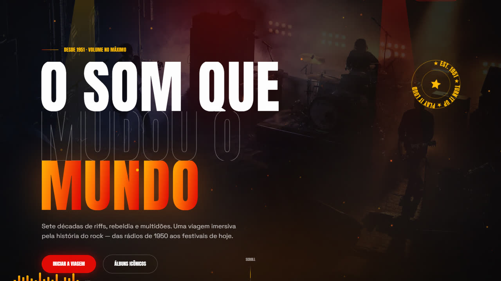
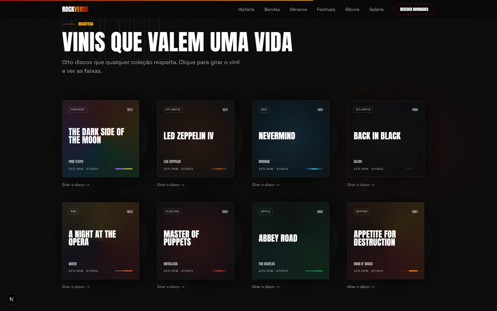

**English** | [Português](README.pt-BR.md)

# ROCKVERSE

A single-page concept site about the history of rock music, built as a MilWeb portfolio piece. The site content is in Brazilian Portuguese.

> **Type:** fan-made concept, non-commercial. Not an official site and not affiliated with any of the bands, artists, record labels or festivals mentioned. Band, album and label names are used for editorial reference only.
>
> **URL configured in the project:** `https://rockverse.vercel.app` (set in `SITE.url`, `constants/data.ts`; not confirmed as a published demo).



## Features

- Sections for history by decade, bands, instruments, genres, festivals, albums, hall of fame, trivia, stats, gallery and newsletter.
- Album covers drawn in CSS (vinyl records), with a "spin the record" interaction that reveals the tracklist.
- Gallery with a lightbox (keyboard and swipe navigation).
- Framer Motion animations, Lenis smooth scrolling, custom cursor and canvas particles.
- Metadata, generated Open Graph image (`app/opengraph-image.tsx`), `robots.txt`, `sitemap.xml` and JSON-LD.



## Stack

- Next.js 16 (App Router), React 19, TypeScript
- Tailwind CSS v4
- Framer Motion
- Lenis (smooth scrolling)

## Getting started

Requirements: Node.js 20 or later (tested with Node 22) and npm.

```bash
npm ci
npm run dev     # http://localhost:3000
npm run build   # production build
npm run start   # serve the build
npm run lint
```

There are no environment variables. The canonical URL used in metadata, robots and sitemap lives in `SITE.url`, in `constants/data.ts`.

## Structure

```
app/         layout, page, OG image, robots and sitemap
sections/    page sections (Hero, History, Bands, Albums, ...)
components/  reusable components (Navbar, cursor, canvas, ...)
constants/   all content in data.ts
animations/  Framer Motion variants
marketing/   vertical promo videos (not part of the build)
docs/        screenshots
```

## Limitations

- The newsletter is visual only: the form shows a local confirmation and does not send data anywhere.
- The footer social icons link to `#` (no real profiles).
- `npm run lint` reports 2 pre-existing React hooks rule errors (`components/CustomCursor.tsx` and `sections/Gallery.tsx`); the build and type check pass.
- Images are loaded from Unsplash at runtime.

## Credits and media

- Photos: Unsplash (loaded from `images.unsplash.com`).
- Fonts: Anton and Space Grotesk via `next/font/google`.
- `marketing/rockverse-tiktok.mp4` and `marketing/rockverse-tiktok-60s.mp4`: promo videos recorded from the site; the origin and rights of their soundtrack and footage are not documented.

## Security

See [SECURITY.md](SECURITY.md).

## License

No license has been chosen yet; all rights reserved by the author.
